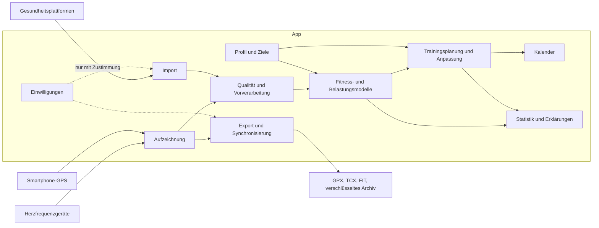

# Architekturüberblick

**Status:** Draft, nicht bindend. Die Quelle schließt Softwarearchitektur und Technologien ausdrücklich aus (CON-0002). Dieses Dokument enthält deshalb nur eine aus den Anforderungen abgeleitete **logische Sicht**. Die Bausteine sind fachliche Zuständigkeiten, keine beschlossenen Komponenten.

## Systemkontext und logische Bausteine

| Baustein | Zuständigkeit | Spezifikation |
|---|---|---|
| Aufzeichnung | GPS und Sensoren, Live-Anzeige, Steuerung | [run-recording.md](../specs/run-recording.md), [sensors.md](../specs/sensors.md) |
| Import | Gesundheitsplattformen | [health-import.md](../specs/health-import.md) |
| Qualität und Vorverarbeitung | Plausibilität, Synchronisation, Qualitätsangaben | [data-quality.md](../specs/data-quality.md) |
| Fitness- und Belastungsmodelle | Zonen, VO₂max, Effizienz, Belastung, Readiness, Energiereserve, Prognose | [vo2max.md](../specs/vo2max.md), [training-load.md](../specs/training-load.md), [readiness.md](../specs/readiness.md), [energy-reserve.md](../specs/energy-reserve.md), [performance-prediction.md](../specs/performance-prediction.md) |
| Profil und Ziele | Basiswerte, Trainingsziele | [profile.md](../specs/profile.md), [goals.md](../specs/goals.md) |
| Planung und Kalender | Planerstellung, Anpassung, Termine | [training-plan.md](../specs/training-plan.md), [plan-adaptation.md](../specs/plan-adaptation.md), [calendar.md](../specs/calendar.md) |
| Statistik und Erklärungen | Auswertung und Begründung | [history-statistics.md](../specs/history-statistics.md), [explanations.md](../specs/explanations.md) |
| Export und Synchronisierung | Dateien, Teilen, Gesamtexport und Reimport | [export-sync.md](../specs/export-sync.md) |
| Einwilligungen | Freigabe, Widerruf, Löschung | [security.md](../quality/security.md) |

## Vertrauensgrenzen

Aus der Quelle ergeben sich diese Grenzen, an denen Daten die App erreichen oder verlassen:

- **Sensoren → App:** Messwerte gelten nicht als fehlerfrei und durchlaufen die Vorverarbeitung (FR-0045). Ein selbst gestarteter Lauf mit gekoppeltem Sensor braucht keine weitere Einwilligung (OQ-0025).
- **Gesundheitsplattform → App:** nur mit Zustimmung und getrennter Freigabe (SEC-0001, SEC-0002).
- **App → Dritte:** nur mit Einwilligung (SEC-0008). Fitnessberechnungen dürfen keine externe Übertragung erzwingen (SEC-0006).

Einen eigenen Server und ein Konto gibt es nicht (ADR-0001).

## Benötigte Architekturentscheidungen

Bisher entschieden: [ADR-0001](adr/ADR-0001-nur-lokale-datenhaltung.md). Am 2026-11-04 hat der Maintainer ADR-0002 bis ADR-0007 freigegeben; der Schutz des Archivs (SEC-0011) liegt als ADR-0008 mit Status `Proposed` vor. Weiterer Bedarf besteht mindestens für:

| Entscheidung | Abhängig von | Entwurf (Status `Proposed`) |
|---|---|---|
| Android-Technologie, Mindestversion und Option für iOS | CON-0001, OQ-0035 | [ADR-0002](adr/ADR-0002-flutter-mindestversion-projektaufbau.md) |
| Speicherung und Verschlüsselung auf dem Gerät | SEC-0009, SEC-0010 | [ADR-0003](adr/ADR-0003-speicherung-und-verschluesselung.md) |
| Austauschbare Algorithmen, Aufbewahrung von Rohdaten und Versionierung der Modelle | NFR-0001, NFR-0005, OQ-0043 | [ADR-0004](adr/ADR-0004-algorithmen-rohdaten-versionierung.md) |
| Aufzeichnung im Hintergrund und Wiederanlauf | FR-0034, OQ-0021 | [ADR-0005](adr/ADR-0005-aufzeichnung-hintergrund-wiederanlauf.md) |
| Anbindung von Bluetooth-Sensoren | FR-0008, OQ-0018 | [ADR-0006](adr/ADR-0006-bluetooth-sensoren.md) |
| Anbindung von Health Connect | FR-0200, OQ-0047 | [ADR-0007](adr/ADR-0007-health-connect.md) |
| Verschlüsselung des passwortgeschützten Archivs | SEC-0011, FR-0192, FR-0198 | [ADR-0008](adr/ADR-0008-verschluesselung-des-archivs.md) |
| Kartenkacheln aus dem Netz nach Einwilligung | FR-0204, SEC-0008, OQ-0074 | [ADR-0009](adr/ADR-0009-kartenkacheln-nach-einwilligung.md) |
| Speicherung und Neuberechnung des Trainingsplans | FR-0156, PAR-203, NFR-0001 | [ADR-0010](adr/ADR-0010-plan-speicherung-und-neuberechnung.md) |
| Puls mit der Handykamera (Kamera-PPG) | FR-0214, FR-0215, OQ-0078 | [ADR-0011](adr/ADR-0011-kamera-ppg.md) |

Die Einordnung der Berechnungsverfahren in die Kategorien aus NFR-0002 steht in [algorithm-categories.md](algorithm-categories.md).

Eine Datei `deployment.md` entfällt, weil es nach ADR-0001 keinen Serverbetrieb gibt.
