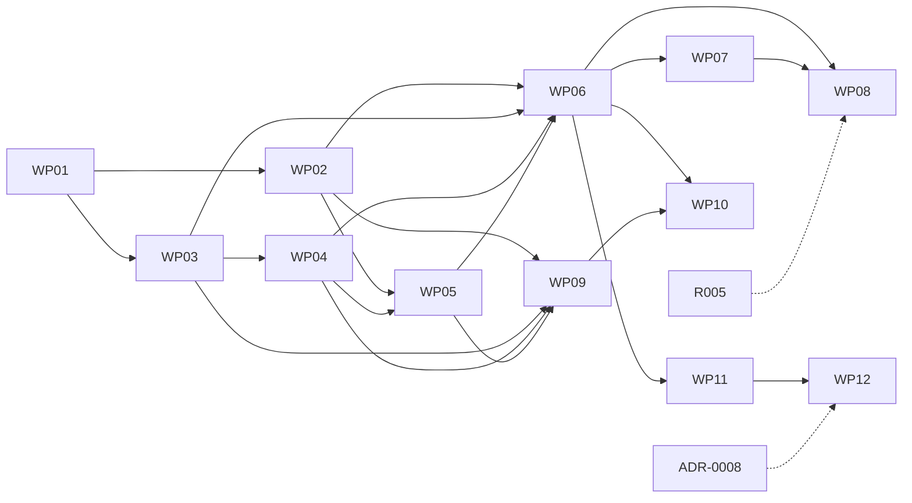

# M1-Plan: Phase 1

Laufaufzeichnung und grundlegende Fitnessanalyse. 12 Pakete, höchstens 2 Sitzungen gleichzeitig. Stand der Pakete nur in [STATUS.md](STATUS.md).

## Wellen

| Welle | Pakete | Voraussetzung | Wartet auf |
|---|---|---|---|
| 1 | [WP01](WP01-projektgeruest-und-gate.md) | ADR-0002 | – |
| 2 | [WP02](WP02-verschluesselte-speicherung.md) ‖ [WP03](WP03-vorverarbeitung-und-bewegungswerte.md) | WP01 | – |
| 3 | [WP04](WP04-algorithmen-zonen-belastung.md) ‖ [WP05](WP05-profil-einstellungen-freigaben.md) | WP04: WP03. WP05: WP02, für den Zoneneditor WP04 | – |
| 4 | [WP06](WP06-lauf-aufzeichnen.md) ‖ [WP09](WP09-vo2max-effizienz-neuberechnung.md) | WP06: WP02 bis WP05. WP09: WP02 bis WP05 | – |
| 5 | [WP07](WP07-pulssensoren.md) ‖ [WP10](WP10-zusammenfassung-historie-statistik.md) | WP07: WP06. WP10: WP06, WP09 | – |
| 6 | [WP08](WP08-hintergrund-und-wiederanlauf.md) ‖ [WP11](WP11-dateiexport-und-teilen.md) | WP08: WP06, WP07. WP11: WP06 | WP08: **wartet auf R005**. WP11: Punkt FIT auf L1 |
| 7 | [WP12](WP12-archiv-und-reimport.md), danach Abschlussprüfung | WP11, WP02 | WP12: ADR-0008 ist freigegeben |

Ist R005 bei Welle 6 nicht fertig, läuft WP11 allein weiter und danach WP12, sobald ADR-0008 freigegeben ist. Ist ADR-0008 früher freigegeben, kann WP12 direkt nach WP11 starten. Nichts außer WP08 hängt an R005, nichts außer WP12 an ADR-0008. Sofort startbar ist nur WP01.

## Gemeinsam berührte Dateien

Wer später mergt, gleicht ab. Innerhalb einer Welle überschneiden sich nur diese Stellen.

| Datei oder Ordner | Pakete | Hinweis |
|---|---|---|
| `tool/gate.sh`, `.github/workflows/gate.yml` | WP01 | danach unverändert |
| Datenbankschema in `app/packages/adapters` | WP02; danach nur per Migration | WP02 legt alle Tabellen von Phase 1 an, damit spätere Pakete nur Zugriffe ergänzen |
| `app/android/app/src/main/AndroidManifest.xml` | WP02, WP06, WP07, WP08, WP11 | Überschneidung in einer Welle nur bei WP08 ‖ WP11 |
| `app/lib/l10n/app_de.arb`, `app_en.arb` | alle mit Oberfläche | Schlüssel mit Präfix je Funktion und Abschnitt je Paket, damit Merge-Konflikte klein bleiben |
| `app/lib/` Zusammenbau der Abhängigkeiten und Einstieg | alle mit Oberfläche | nur Einzeiler je Funktion, Rest unter `app/lib/features/<funktion>/` |
| `app/packages/core/lib/core.dart` | alle in `core` | nur Exportzeilen |
| `app/lib/features/run/` | WP06, WP07, WP08 | nicht in derselben Welle |
| `app/lib/features/settings/` | WP05, WP09 | nicht in derselben Welle |
| `app/lib/features/storage/` | WP02, WP12 | nicht in derselben Welle |
| `app/pubspec.yaml`, `app/packages/*/pubspec.yaml`, Lock-Datei | WP02, WP07, WP12 | Lock-Datei nach dem Abgleich neu auflösen; parallele `flutter pub get` einzeln wiederholen |

Getrennt arbeiten dürfen: WP02 ‖ WP03, WP04 ‖ WP05 (Teil Zoneneditor nach WP04), WP06 ‖ WP09, WP07 ‖ WP10, WP08 ‖ WP11. Jede Sitzung nutzt ein eigenes AVD mit explizitem Serial.

## Abschlussprüfung M1

Nach dem letzten Merge, durch den Agenten `running-app-e2e` auf `main`, kein eigenes Paket:

- ACC-01, ACC-03 (mit Test-Sensor), ACC-04, ACC-05, ACC-06, ACC-13, ACC-14, ACC-15 durchgehend an einem synthetischen Lauf.
- Rundgang: Lauf, Werte, Export, Archiv, Reimport auf zweitem AVD.
- SEC-0008: Berechtigungsliste des Release-APK ohne `INTERNET` und ohne Hintergrundstandort; Lizenzbaum aller Abhängigkeiten.
- Der Test-Sensor fehlt im Release-APK.
- Für den Status offen bleiben FR-0034 unter Feldbedingungen, ACC-02 und Akku. Sie sind kein Abnahmekriterium und werden in `STATUS.md` nicht als erfüllt geführt.

## Lücken und Widersprüche in der Spec

Nur gemeldet, nichts davon ist hier entschieden. „Blockiert“ nennt, was ohne Antwort offen bleibt; der Rest des Pakets läuft.

| Nr. | Punkt | Paket | Blockiert | Vorschlag |
|---|---|---|---|---|
| L1 | **FIT:** FR-0182 verlangt FIT, aber kein Paket und keine ADR legen den Weg fest. Das Garmin-SDK steht unter einer eigenen Lizenz (Verbreitung, Kündigungsrecht; Volltext war nicht abrufbar), die GPL-Verträglichkeit ist ungeprüft (OQ-0048). Formatversionen sind offen (OQ-0032) | WP11 | FIT-Teil | Entschieden 2026-11-06: eigener Kodierer ohne Garmin-Code; Rechtsfrage zum Protokoll bleibt in OQ-0048 |
| L2 | **Karte:** FR-0037 nennt „GPS-Karte“, FR-0041 „GPS-Route“. Kein Kartenmaterial ist festgelegt; Kacheln aus dem Netz gäben den Standort an Dritte (SEC-0008) und bräuchten `INTERNET` | WP10 | nichts, solange die gezeichnete Route genügt | Gezeichnete Route ohne Netz für Phase 1 |
| L3 | **Profilfelder:** Für „Fitness-/Lauferfahrung“ und die Selbsteinschätzung in FR-0002 fehlt eine Werteliste; PAR-192 kennt keine Trainingsstufen mehr. Für Alter, Gewicht und Größe gibt es keine Plausibilitätsgrenzen | WP05 | diese Felder | Zwei Felder bis Phase 2 zurückstellen; bei den übrigen nur positive Zahlen |
| L4 | **Persönliche Bestzeiten** (FR-0043): keine Definition, keine liefernde Anforderung | WP10 | diese Kennzahl | Bis zur Definition nicht anzeigen |
| L5 | **Einordnung** (FR-0037, OQ-0037): „Schnitt der letzten 5 Läufe“ nennt keine Größe | WP10 | diesen Punkt | Maintainer nennt die Größe, etwa Pace |
| L6 | **Lücke nach Abbruch** (FR-0193): Zählt die Zeit des Ausfalls zur Gesamtzeit? Zur Bewegungszeit? | WP08 | diesen Punkt | Gesamtzeit ja, Bewegungszeit nein |
| L7 | **Freigaben:** SEC-0001, SEC-0002 und SEC-0007 gelten ab Phase 1, aber ihre Quellen (Plattform-Import, Strava) kommen erst in Phase 3 oder sind zurückgestellt | WP05 | nichts | Nur Logik und Schema mit Fake-Quelle, Oberfläche mit der ersten echten Quelle |
| L8 | **Virtueller Sensor:** R006 (ADR-0006) ist nicht beauftragt. Ohne ihn prüft der Emulator `universal_ble` nur beim Bau; Abbruch und Wechsel laufen über den Fake | WP07, WP08 | nichts | Entschieden 2026-11-06: WP07 ohne R006, der echte BLE-Weg bleibt dem Feldtest |
| L9 | **Formatversionen** (OQ-0032) für GPX, TCX, FIT | WP11 | nichts | Paket schlägt vor, Maintainer bestätigt |
| L10 | **Neueres Archiv in älterer App** (ADR-0004) | WP12 | wird über ADR-0008 C entschieden | Ablehnen |
| L11 | **Zonen:** FR-0061 nennt keine Regeln für gültige Grenzen und nicht, ob gespeicherte Zonenzeiten alter Läufe bleiben | WP05 | Validierung im Editor | Lückenlos und aufsteigend; alte Läufe bleiben |
| L12 | **Autopause:** Standard an oder aus fehlt (FR-0029). Bei FR-0027 ist offen, ob die optionalen Anzeigen wählbar sind | WP06 | nichts | Aus; Anzeigen immer sichtbar |
| L13 | **Archivinhalt:** FR-0192 nennt Ziele, Pläne und Warnmeldung, die es erst in Phase 2 gibt | WP12 | nichts | Abschnitte vorsehen, in Phase 1 leer |
| L14 | **Ohne Anwendungsfall in Phase 1:** SEC-0009 „Zugangsdaten externer Dienste“; SEC-0004 Hinweis zu Strava nur als allgemeiner Hinweis auf weitergegebene Dateien | WP02 | nichts | So belassen |
| L15 | **Lokale Umgebung:** Installiert ist Flutter 3.47.7 mit Dart 3.13.5, ADR-0002 nennt 3.47.9 mit Dart 3.13.7; AVDs gibt es nur für API 35, ADR-0002 will API 31 und 36 | WP01 | WP01 bis zur Angleichung | Lokal aktualisieren |
| L16 | **Veraltete Verweise:** `work-packages/REVIEW.md` nennt `docs/ARCHITECTURE.md`; `AGENTS.md` nennt den Stand „nur Spezifikation“ | WP01 | nichts | WP01 zieht nach |
| L17 | **Statistik:** Laut FR-0043 erscheinen Kennzahlen späterer Phasen erst mit ihrer Funktion, das Kriterium verlangt je Kennzahl „berechnet oder nicht verfügbar“ | WP10 | nichts | Spätere ausblenden, Kriterium gilt für die sichtbaren |

## Zuordnung aller Anforderungen

113 Anforderungen der Phase `1` oder `1*`, darunter FR-0025, FR-0027 und FR-0043 mit Phase-1-Anteil. Jede steht genau einmal hier. Das zuständige Paket schließt die Akzeptanzkriterien ab; andere Pakete halten die Regel ein, wo sie sie berühren.

| ID | Titel | Phase | Paket |
|---|---|---|---|
| FR-0001 | Profil beim ersten Start einrichten | 1 | WP05 |
| FR-0002 | Profildatenfelder | 1 | WP05 |
| FR-0003 | Gemessene maximale Herzfrequenz hat Vorrang | 1 | WP05 |
| FR-0004 | Altersbasierte Näherung der maximalen Herzfrequenz | 1 | WP05 |
| FR-0005 | Hinweis auf Streuung und Korrektur der Näherung | 1 | WP05 |
| FR-0006 | Neuberechnung nach Änderung der Basiswerte | 1 | WP09 |
| FR-0007 | Unterstützte Gerätekategorien | 1 | WP07 |
| FR-0008 | Automatische Erkennung standardisierter Geräte | 1 | WP07 |
| FR-0011 | Geräte suchen | 1 | WP07 |
| FR-0012 | Gerät verbinden und trennen | 1 | WP07 |
| FR-0013 | Mehrere bekannte Geräte speichern | 1 | WP07 |
| FR-0014 | Bevorzugtes Gerät festlegen | 1 | WP07 |
| FR-0015 | Aktuelle Herzfrequenz anzeigen | 1 | WP07 |
| FR-0016 | Batteriestand anzeigen, sofern bereitgestellt | 1 | WP07 |
| FR-0017 | Verbindungsabbrüche erkennen | 1 | WP07 |
| FR-0018 | Datenquelle während des Trainings wechseln | 1 | WP07 |
| FR-0019 | Eindeutige Priorisierung ohne Vermischung | 1 | WP07 |
| FR-0020 | Herkunft der Messwerte dokumentieren | 1 | WP07 |
| FR-0025 | Freie oder geplante Einheit starten | 1 (frei), 2 (aus Plan) | WP06 |
| FR-0026 | Pflichtanzeigen während des Trainings | 1 | WP06 |
| FR-0027 | Optionale Anzeigen während des Trainings | 1 (Teil), 2 (Teil) | WP06 |
| FR-0028 | Training starten, pausieren, fortsetzen, beenden | 1 | WP06 |
| FR-0029 | Automatisches Pausieren | 1 | WP06 |
| FR-0030 | Manuelle Rundenmarkierung | 1 | WP06 |
| FR-0034 | Aufzeichnung bei ausgeschaltetem Bildschirm | 1 | WP08 (ungeprüft im Feld) |
| FR-0035 | Aufzeichnung ohne Pulssensor | 1 | WP06 |
| FR-0036 | Verbindungsabbruch verliert den übrigen Lauf nicht | 1 | WP07 |
| FR-0037 | Zusammenfassung nach dem Lauf | 1 | WP10 |
| FR-0040 | Trainingshistorie | 1 | WP10 |
| FR-0041 | Detailansicht eines Laufs | 1 | WP10 |
| FR-0042 | Pace und Herzfrequenz zeitlich vergleichen | 1 | WP10 |
| FR-0043 | Statistische Kennzahlen | 1 (je Kennzahl) | WP10 |
| FR-0044 | Auswertungszeiträume | 1 | WP10 |
| FR-0045 | Keine Fitnessberechnung auf ungefilterten Daten | 1* | WP03 |
| FR-0046 | Synchronisation über Zeitstempel | 1* | WP03 |
| FR-0047 | Zu berücksichtigende Datenprobleme | 1* | WP03 |
| FR-0048 | Qualitätsbewertung je Abschnitt | 1* | WP03 |
| FR-0049 | Strecke aus plausiblen Positionsdistanzen | 1 | WP03 |
| FR-0050 | Geschwindigkeit und Pace | 1 | WP03 |
| FR-0051 | Geglättete Tempoanzeige | 1 | WP03 |
| FR-0052 | Bewegungszeit und Gesamtzeit getrennt | 1 | WP03 |
| FR-0053 | Metadaten jedes fortgeschrittenen Fitnesswerts | 1* | WP04 |
| FR-0054 | Qualitätsstufen sind keine Genauigkeitsangaben | 1* | WP10 |
| FR-0055 | Funktionen je Datenverfügbarkeitsstufe | 1* | WP10 |
| FR-0056 | Fehlender Sensorwert ist keine Nullmessung | 1 | WP03 |
| FR-0057 | Vier Zustände eines Messwerts | 1 | WP03 |
| FR-0058 | Ursprüngliche und neu berechnete Werte unterscheiden | 1* | WP09 |
| FR-0059 | Nachvollziehbarkeit eines geschätzten Werts | 1* | WP10 |
| FR-0060 | Herzfrequenzreserve und relative Auslastung | 1 | WP04 |
| FR-0061 | Fünf konfigurierbare Zonen | 1 | WP05 |
| FR-0062 | Vorläufiges Zonenmodell auf Basis der Herzfrequenzreserve | 1 | WP04 |
| FR-0063 | Bereiche unter Zone 1 separat ausweisen | 1 | WP04 |
| FR-0064 | Zonen als Näherung kennzeichnen | 1 | WP10 |
| FR-0066 | Schätzung aus gewöhnlichen Läufen | 1 | WP09 |
| FR-0067 | Kennzeichnung als indirekte Schätzung | 1 | WP10 |
| FR-0068 | Eingabedaten | 1 | WP09 |
| FR-0069 | Sauerstoffbedarf nach ACSM-Laufformel | 1 | WP09 |
| FR-0070 | Grenzen der ACSM-Laufformel beachten | 1 | WP09 |
| FR-0071 | Hochrechnung auf VO2max | 1 | WP09 |
| FR-0072 | Keine Genauigkeit ohne Validierung versprechen | 1 | WP10 |
| FR-0073 | Auswahl geeigneter Abschnitte | 1 | WP09 |
| FR-0074 | Klare Laufgeschwindigkeit, keine unkritische Bewertung des Gehens | 1 | WP09 |
| FR-0075 | Schwellenwerte sind Modellparameter | 1 | WP09 |
| FR-0076 | Verarbeitung eines Laufs | 1 | WP09 |
| FR-0077 | Abweichende Schätzungen senken die Konfidenz | 1 | WP09 |
| FR-0078 | Stabiler langfristiger Wert | 1 | WP09 |
| FR-0079 | Mögliche Glättung des langfristigen Werts | 1 | WP09 |
| FR-0080 | Keine Aktualisierung bei unzureichender Qualität | 1 | WP09 |
| FR-0081 | Drei Sichten auf die VO2max | 1 | WP10 |
| FR-0084 | Kennzahl für aerobe Laufeffizienz | 1 | WP10 |
| FR-0085 | Referenzgeschwindigkeit | 1 | WP09 |
| FR-0086 | Vergleichbare Bedingungen | 1 | WP09 |
| FR-0087 | Veränderung der aeroben Effizienz | 1 | WP09 |
| FR-0088 | Abgrenzung zur VO2max | 1 | WP10 |
| FR-0091 | Belastung erfassen | 1 | WP04 |
| FR-0092 | Edwards-TRIMP als erste Variante | 1 | WP04 |
| FR-0093 | TRIMP-Zonen beziehen sich auf die maximale Herzfrequenz | 1 | WP04 |
| FR-0094 | TRIMP nicht als Maß für Ermüdung darstellen | 1 | WP10 |
| FR-0182 | Dateiexport als GPX, TCX und FIT | 1 | WP11 |
| FR-0183 | Exportinhalte | 1 | WP11 |
| FR-0192 | Gesamtexport der Nutzerdaten | 1 | WP12 |
| FR-0193 | Laufende Sicherung und Wiederaufnahme | 1 | WP08 |
| FR-0194 | Verhalten bei GPS-Verlust | 1 | WP06 |
| FR-0195 | Start nur mit Standortberechtigung | 1 | WP06 |
| FR-0198 | Reimport des Gesamtexports | 1 | WP12 |
| FR-0201 | Export teilen | 1 | WP11 |
| FR-0202 | Schrittfrequenz aus dem Smartphone | 1 | WP08 |
| NFR-0001 | Algorithmen versionierbar und nachvollziehbar | 1* | WP04 |
| NFR-0002 | Einordnung in drei Verfahrenskategorien | 1* | WP04 |
| NFR-0003 | Heuristiken nicht als validiert darstellen | 1* | WP10 |
| NFR-0004 | Validierung vor Genauigkeitsaussagen | 1* | WP10 |
| NFR-0005 | Austauschbare Algorithmen | 1* | WP04 |
| NFR-0006 | Sprachen und Einheiten | 1 | WP05 |
| SEC-0001 | Gesundheitsdaten nur mit ausdrücklicher Zustimmung | 1 | WP05 |
| SEC-0002 | Datenquellen getrennt freigeben | 1 | WP05 |
| SEC-0003 | Externe Synchronisierung ist optional | 1 | WP11 |
| SEC-0004 | Export und Löschung der eigenen Daten | 1 | WP02 |
| SEC-0005 | Datenherkunft erkennbar | 1 | WP10 |
| SEC-0006 | Berechnungen ohne zwingende externe Übertragung | 1 | WP09 |
| SEC-0007 | Berechtigungen widerrufen | 1 | WP05 |
| SEC-0008 | Keine Übertragung an Dritte ohne Einwilligung | 1 | WP05 |
| SEC-0009 | Verschlüsselte Speicherung | 1 | WP02 |
| SEC-0010 | System-Backups immer aus | 1 | WP02 |
| SEC-0011 | Verschlüsseltes Archiv | 1 | WP12 |
| CON-0001 | Zielplattformen | 1 | WP01 |
| CON-0002 | Technik ist nicht Gegenstand der Quelle | 1 | WP01 |
| CON-0003 | Geräteunabhängigkeit | 1 | WP07 |
| CON-0004 | Funktionalität ohne Wearable | 1 | WP06 |
| CON-0005 | Transparente Berechnungen | 1 | WP10 |
| CON-0007 | Optionale Gesundheitsdaten | 1 | WP05 |
| CON-0008 | Datenhoheit | 1 | WP11 |
| CON-0009 | Kennzeichnung von Unsicherheit | 1 | WP10 |
| CON-0010 | Unabhängigkeit von externen Plattformen | 1 | WP11 |

**Stand der Lücken (2026-11-04):** L1 durch OQ-0066, L2 bis L6, L11 und L12 durch OQ-0065, L10 durch ADR-0008, L15 durch Festschreiben von Flutter 3.47.7 entschieden (ADR-0002). L8 entschieden (WP07 ohne R006), L9 vom Maintainer in WP11 bestätigt (2026-11-06, K29). Keine Lücke mehr offen. Die Vorschläge zu L7, L13, L14, L16 und L17 gelten.
