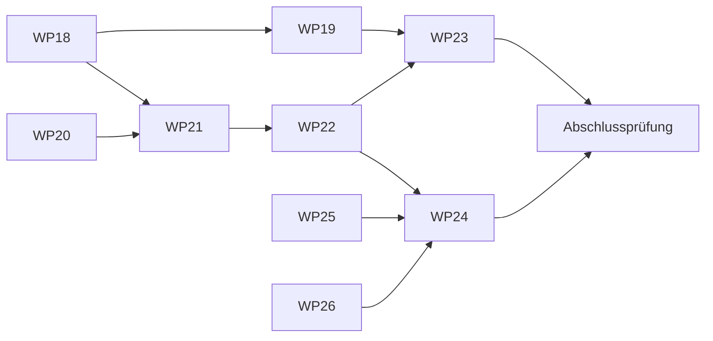

# M2-Plan: Phase 2

Adaptiver Trainingscoach. 9 Pakete, höchstens 2 Sitzungen gleichzeitig. Stand der Pakete nur in [STATUS.md](STATUS.md). Vorgaben zum Start: OQ-0077.

## Wellen

| Welle | Pakete | Voraussetzung |
|---|---|---|
| 1 | [WP18](WP18-subjektive-angaben-nachtragen.md) ‖ [WP20](WP20-leistungsprognose.md) | M1 |
| 2 | [WP19](WP19-belastungsverlauf-belastungsprofil.md) ‖ [WP21](WP21-planmodell-planerzeugung.md) | WP19: WP18. WP21: WP18, WP20 |
| 2b | [WP26](WP26-rr-intervalle-speichern.md) | M1; nach WP20, vor WP24 (nachgereicht am 2026-11-09, DEC-0072) |
| 3 | [WP22](WP22-plan-seite-ziele-kalender.md) ‖ [WP25](WP25-laufband-zusatzmetriken.md) | WP22: WP21. WP25: M1 |
| 4 | [WP23](WP23-plananpassung-warnsignal-erklaerungen.md) ‖ [WP24](WP24-gefuehrte-einheit-ansagen.md) | WP23: WP19, WP22. WP24: WP22, für den Laufband-Fall WP25 |
| 5 | Abschlussprüfung M2 | alle |

## Gemeinsam berührte Dateien

- **WP18 und WP20:** Texte (`app_*.arb`) je mit eigenem Präfix; `Fortschritt` nur WP20.
- **WP19 und WP21:** Datenbankschema: Wer später mergt, setzt seine Migration auf die neue Version.
- **WP22 und WP25:** Navigation nur WP22; `run_flow_screen.dart` nur WP25.
- **WP26:** `heart_rate_parser.dart`, Aufzeichnung, Schema und Archiv; Schema und Archivabschnitt nach den zuvor gemergten Paketen. WP24 baut darauf auf.
- **WP23 und WP24:** `home` nur WP23, `run` nur WP24; beide lesen die Einheit über dieselbe Schnittstelle aus WP21.

## Für alle Pakete

- **Regeln:** Zahlen aus `docs/planning-rules.md` und `docs/phase-2-3-rules.md`, als benannte Parameter mit PAR-Nummer, nie frei im Code. Berechnung in `app/packages/core`, Oberfläche nur anzeigend.
- **Neue Daten:** Jede neue Tabelle oder Spalte gehört mit Migration und Test in den Gesamtexport (Archiv), den Reimport und das Löschen (SEC-0001 bis SEC-0010). Ändert sich das Archivformat, kommt eine neue Formatversion nach `docs/contracts/archive.md`, und ältere Archive bleiben lesbar.
- **Erscheinungsbild:** FR-0205 mit den Festlegungen aus OQ-0077. Hell und dunkel, de und en, 48 dp, keine Farbwerte außerhalb des Themes. Beispielwerte des Designs sind keine Vorgaben.
- **Texte:** Keine Diagnosen und keine Sicherheitsversprechen (FR-0118, FR-0149). Werte sind Schätzungen und tragen ihre Grundlage (FR-0054, PAR-106).
- **Nicht dazu:** Phase 3 (Health Connect, HRV, Readiness-Zahl), Energiereserve, Marathonpläne, automatische Änderung von Terminen oder Ziel.
- **Abnahme:** Akzeptanzkriterien der genannten FRs, Mutationsbelege für die Kernregeln, E2E auf API 36 und 31 (separater Agent, nur Emulator), Gate grün.
- **Release:** Bleibt bis OQ-0048 gesperrt.

## Abschlussprüfung M2

Ein Jahr Plan im Schnelldurchlauf über die Kernlogik; E2E vom Anlegen eines Ziels über eine geführte Einheit bis zur Anpassung; Netzprüfung wie in M1; Archiv mit allen neuen Daten hin und zurück; Abgleich mit `Plan.dc.html`, `Intervall.dc.html`, `Main.dc.html`, `Summary.dc.html`, `Start.dc.html`.
