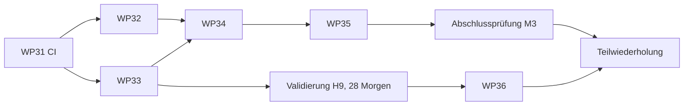

# M3-Plan: Phase 3

Erweiterte Gesundheits- und Erholungsanalyse. 5 Pakete (WP32 bis WP36), höchstens 2 Sitzungen gleichzeitig. Stand der Pakete nur in [STATUS.md](STATUS.md). Grundlage: K45 bis K47, K61 (geht vor), DEC-0073, DEC-0074, R009, Regelversion K-1. Energiereserve gehört nicht dazu (Phase 4, DEC-0060).

## Voraussetzungen vor Welle 1

1. **WP24 und WP30 gemergt** (laufen gerade; WP30 ändert `tool/gate.sh` und `build.gradle.kts`, die WP32 ebenfalls braucht).
2. **WP31 (CI) gemergt:** Volles Gate und E2E-Regression laufen danach auf GitHub; die Sitzungen pushen ihre `wp/`-Branches. Vor WP31 startet kein M3-Paket.
3. **Konzept nach K61 nachgezogen** (Orchestrator, Bestätigung durch den Maintainer), damit kein Paket gegen eine freigegebene Anforderung baut:
   - Schalter „adaptiv“/„fix“ als neue Anforderung (Plan-Spec); FR-0157 und FR-0158 (Teil „3 (Erholung)“) und PAR-173 gelten nur bei „adaptiv“; Warnsignal (FR-0203) und M2-Anpassungen gelten immer.
   - Entwicklermodus als neue Anforderung; FR-0215 und die Validierungssperre in K-1 bekommen: Die Morgenmessung ist bis zur bestandenen Validierung nur im Entwicklermodus nutzbar (K62 F1); dort gelten Ruhepuls und RMSSD der Morgenmessung vollständig als gültige Werte, als wäre die Validierung bestanden, ohne Kennzeichnung (K62 Punkt 6, ersetzt „experimentell, nicht geprüft“ aus K61); dazu das parallele Speichern der Gurt-RR mit Export der Messpaare als CSV (K62 F4).
   - FR-0023/FR-0199: Fremde Trainings und Puls nur Anzeige, gezählt erst nach „als Training übernehmen“ (K62 F2).
   - Ausnahme zu R009, Abschnitt 6 (Validierungsplan): Der Referenzwert kommt aus den RR, die die App selbst vom Gurt speichert, statt aus einer Logger-App (Punkt in WP36).
4. **Entscheidungen K62** (unten) ins Änderungsprotokoll eintragen.

## Wellen

| Welle | Pakete | Voraussetzung |
|---|---|---|
| 0 | WP31 (CI, kein M3-Paket) | WP30 |
| 1 | [WP32](WP32-health-connect-import.md) ‖ [WP33](WP33-morgenmessung-entwicklermodus.md) | WP31, WP24, WP30; Konzept nach K61 und K62 |
| 2 | [WP34](WP34-readiness.md) | WP32, WP33 |
| 2b | Validierungsmessung (Folgeanalyse zu R009, Nummer nach `research/README.md`) | WP33 und [WP37](WP37-morgenmessung-feldtest.md) gemergt, Debug- oder Release-APK beim Maintainer; 28 Referenzmorgen (4–6 Wochen), keine Agenten-Sitzung bis zur Auswertung |
| 3 | [WP35](WP35-erholungsbasierte-anpassung.md) | WP34 |
| 4 | Abschlussprüfung M3 | WP32 bis WP35 |
| 5 | [WP36](WP36-validierung-uebernehmen.md), danach Teilwiederholung der Abschlussprüfung | Ergebnis der Validierung |

Welle 2 hat nur ein Paket, weil WP34 beide Datenquellen braucht und WP35 den Readiness-Wert. Der freie Platz gehört der Validierungsmessung, die der Maintainer selbst führt.

## Schema und Archiv

| Paket | Schema | Archivabschnitte |
|---|---|---|
| WP32 | ja | 5 neue (Schlafsitzungen, Schlafphasen, Einzelwerte, Trainingseinheiten, Pulswerte der Einheiten) |
| WP33 | ja | 2 neue (Morgenmessungen, Gurt-RR der Morgenmessung) |
| WP34, WP35, WP36 | nein | keine; Zustände in `settings` |

**Wer zuerst mergt, nimmt Schema 12 und die Abschnitte ab 27;** das andere Paket zieht auf Schema 13 und die folgenden Abschnittsnummern nach (Migration, `archiveSectionsFor`, Vektor, Vertrag). Formatversion bleibt 2, solange Format 2 unveröffentlicht ist (OQ-0048).

## Gemeinsam berührte Dateien

- **WP32 und WP33:** `schema.drift`, `app_database.dart`, `delete_access.dart`, Archivabschnitte und Vektoren (Regel oben). Übersicht hinter dem Profil-Symbol (`overview_screen.dart`) nur WP33 (Eintrag „Über“); WP32 hängt sich an `permissions_screen.dart` und den Abschnitt „Daten“. Android-Manifest und `release_rechte()` in `tool/gate.sh` nur WP32. `features/measure` und `core/src/ppg` nur WP33. Texte mit Präfix `health` (WP32) bzw. `morning`/`dev` (WP33).
- **Archiv-Wiederherstellung:** `ArchiveRestoreService.isEmpty` (core, `archive_restore.dart`) muss jede neue Tabelle zählen, sonst wird eine Datenbank mit nur neuen Daten ohne Rückfrage ersetzt. WP32 baut die Zählung über einen core-Port (Teil C1); WP33 trägt seine Tabellen dort ein, wer später mergt, ergänzt die Liste.
- **WP33:** `home` nur für den Einstieg in die Morgenmessung (eine Karte oder ein Knopf). WP34 baut die Karte „Erholung“ danach um.
- **WP34:** `home` (Karte „Erholung“), neues `features/readiness`, `core/src/readiness`. Liest WP32 und WP33 nur über deren Ports.
- **WP35:** `core/src/plan`, `features/plan`. `home` nur für den Satz unter der Karte „Erholung“ (nach WP34).

## Für alle Pakete

- **Regeln:** Zahlen aus `docs/phase-2-3-rules.md` (PAR-147 bis PAR-150, PAR-160 bis PAR-173, PAR-189, Abschnitt 7 K-1), als benannte Parameter mit PAR-Nummer, nie frei im Code. Berechnung in `app/packages/core`, Oberfläche nur anzeigend. Readiness als versioniertes Modell (NFR-0001).
- **Gesundheitsdaten (SEC-0001 bis SEC-0010):** Nichts aus Health Connect und keine Messung wird ohne Einwilligung gelesen oder verwendet. Jede neue Tabelle mit Migration und Test in Archiv, Reimport und Löschen. Keine Werte in Logs. Test- und Vektordaten nur synthetisch; `~/ai/puls` und `research/input/` werden nicht gelesen.
- **Texte:** Keine Diagnosen (FR-0118), keine Sätze wie „du bist erholt“ oder „bereit“ (PAR-174, PAR-184); Werte sind Schätzungen mit Stufe und Grund (PAR-159). Kamera-RMSSD heißt nie „validiert“.
- **Erscheinungsbild:** FR-0205; neue Seiten zuerst als Screens mit Claude Design im Stil von `design/` (je Paket ein Teil 0), Freigabe durch den Maintainer. Hell und dunkel, de und en, 48 dp.
- **Testumgebung:** nur Emulator. Health Connect: auf API 36 als Systemteil vorhanden, auf API 31 fehlt es in der Regel. Abnahme deshalb mit einer Debug-Quelle (Fake-Adapter wie Test-Sensor und Fake-Kamera, nur über `main_debug.dart`, Marker im Gate) und auf API 36 zusätzlich der echte Berechtigungsdialog ohne Daten. Kamera nur über die Fake-Kamera aus WP27, Gurt-RR über den Test-Sensor aus WP07/WP26. Echte Quell-Apps, echte Kamera und echter Gurt bleiben **ungeprüft** und werden in `STATUS.md` offen geführt.
- **Abnahme:** Akzeptanzkriterien der genannten FRs, Mutationsbelege für die Kernregeln, Gate grün auf GitHub (WP31), E2E auf API 36 und 31 (separater Agent). **E2E-Tests, die sich lohnen, werden als committete Tests in `app/integration_test/` hinterlegt, nicht uncommittet in `handoff/`.**
- **Release:** bleibt bis OQ-0048 gesperrt.

## Entscheidungen des Maintainers (K62, 2026-11-13)

- **F1 – Morgenmessung ohne Entwicklermodus (Variante b):** Die Morgenmessung (FR-0215) ist bis zur bestandenen Validierung nur im Entwicklermodus nutzbar („solange wir das noch nicht sicher freigeschaltet haben, kann man das nur nutzen, wenn man Entwickler ist“). Nach dem Bestehen gilt K-1 für alle. Folge: Ohne Entwicklermodus und ohne Uhr gibt es bis dahin nur die Basisstufe aus WP23. Betrifft WP33, WP34, WP36.
- **F2 – Trainings und Puls aus Health Connect (Variante a):** Nur Anzeige im Verlauf mit Quelle und Pulskurve; gezählt wird erst nach „als Training übernehmen“ (Nachtrag nach FR-0199, Dauer vorausgefüllt, RPE fragt die App). Betrifft WP32.
- **F3 – Morgen-Erinnerung nach einem Neustart (Variante b):** Keine neue Ausnahme zu SEC-0009; nach einem Neustart des Geräts plant erst das nächste Öffnen der App die Erinnerung neu. Betrifft WP33.
- **F4 – Export der Messpaare (Variante a):** Unverschlüsselte CSV über Teilen, nur im Entwicklermodus, mit Warnhinweis vor dem Teilen wie bei der Zusatzmetriken-CSV (K57). Betrifft WP33.
- **Punkt 6 – Morgenwerte im Entwicklermodus:** Im Entwicklermodus gelten Ruhepuls und RMSSD der Morgenmessung vollständig als gültige Werte, so als wäre die Validierung bestanden: in Trends, Kurven, Readiness und bei „adaptiv“ im Plan, ohne Sonderbehandlung, ohne Einschränkung der Anzeige und ohne Opt-in. Das ersetzt die Kennzeichnung „experimentell, nicht geprüft“ aus K61; höchstens ein unauffälliger Hinweis „Entwicklermodus aktiv“. Intern bleibt an der Messung das Merkmal „vor der Validierung gemessen“, das Anzeige und Rechnung nicht ändert. Die Qualitätsgrenze je Messung (unbrauchbare Messungen verwerfen) bleibt. Ohne Entwicklermodus: keine Morgenmessung bis zur Validierung. Betrifft WP33, WP34, WP35.

## Abschlussprüfung M3

- Kernlogik: 60 Tage synthetische Reihen (Uhr, Kamera liegend und sitzend, beide am selben Tag, Lücken, Quellwechsel) laufen durch Readiness und Plan; alle Fälle der Validierungssperre (nicht geprüft, bestanden mit und ohne Opt-in, eingeschränkt, nicht bestanden) mit und ohne Entwicklermodus, bei „fix“ und „adaptiv“.
- Ohne Entwicklermodus ist die Morgenmessung vor bestandener Validierung nirgends erreichbar (K62 F1).
- E2E vom Einwilligen in Health Connect (Debug-Quelle) über die Morgenmessung im Entwicklermodus (Fake-Kamera, Test-Sensor mit RR) bis zur Readiness-Karte und, bei „adaptiv“, der gelockerten intensiven Einheit; Widerruf mit Löschfrage.
- Release-APK: Health-Connect-Rechte genau nach Liste, keine Schreibrechte, kein Hintergrundlesen, Debug-Quellen nicht enthalten. Netzprüfung wie in M1 (keine neuen Hosts).
- Archiv mit allen neuen Tabellen hin und zurück; „Alles löschen“ leert sie.
- Offen bis WP36: Freigabe der Kamera-RMSSD und die RMSSD-Qualitätsgrenze.
